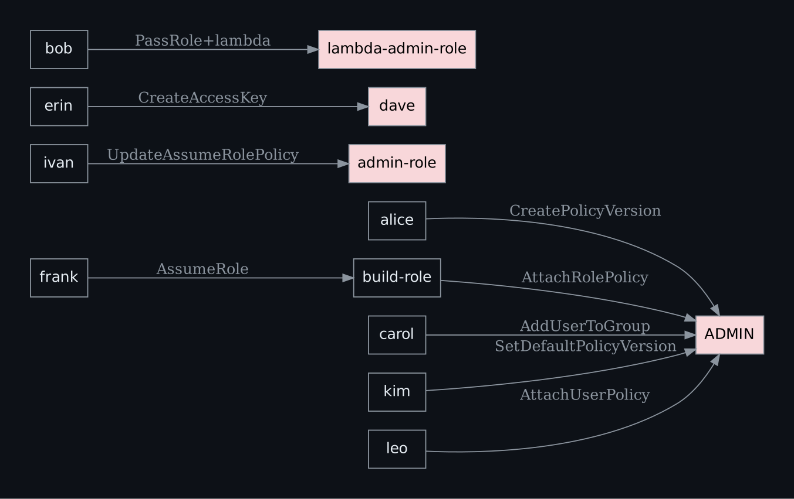

# cloud-iam-paths

An AWS account can look locked down user by user and still be one hop from full admin. A developer who can `iam:CreatePolicyVersion` on the policy attached to their own group **is** an administrator, they just have not typed the command yet. **cloud-iam-paths** reads your IAM export, builds the graph of "who can become whom", and prints the shortest escalation path from every principal to administrator access.

Go, standard library only, offline. It reads a file; it never calls AWS.



## Usage

```bash
aws iam get-account-authorization-details > account.json
go run ./cmd/cloud-iam-paths account.json
go run ./cmd/cloud-iam-paths -md report.md -json result.json -dot paths.dot account.json
go run ./cmd/cloud-iam-paths -fail-on-path account.json   # exit 1 in CI if any path exists
```

`examples/account.json` is a made-up account (id 111122223333) with one example of each technique. Output on it:

```text
alice (user): 1 step to admin
  1. alice -> ADMIN  [CreatePolicyVersion]
     Publish a new default version of the attached policy DevPolicy that allows everything.
     needs: iam:CreatePolicyVersion on arn:aws:iam::111122223333:policy/DevPolicy
...
frank (user): 2 steps to admin
  1. frank -> build-role  [AssumeRole]
  2. build-role -> ADMIN  [AttachRolePolicy]
```

## Techniques covered

| Technique | What the principal needs |
|---|---|
| `CreatePolicyVersion` | `iam:CreatePolicyVersion` on a managed policy attached to them (directly or through a group) |
| `SetDefaultPolicyVersion` | `iam:SetDefaultPolicyVersion` on an attached policy that has an older admin version |
| `AttachUserPolicy` / `PutUserPolicy` | the permission on their own user |
| `AttachGroupPolicy` / `PutGroupPolicy` | the permission on a group they belong to |
| `AttachRolePolicy` / `PutRolePolicy` | the permission on their own role, or on a role they can already assume |
| `AddUserToGroup` | the permission on a group that has admin |
| `CreateAccessKey` / `CreateLoginProfile` / `UpdateLoginProfile` | the permission on another user, giving that user's access |
| `AssumeRole` | the trust policy names them, or trusts the account root and they hold `sts:AssumeRole` |
| `UpdateAssumeRolePolicy` | the permission on a role, to rewrite its trust and then assume it |
| `PassRole+<service>` | `iam:PassRole` on a role **that the service trusts**, plus the service call: EC2 `RunInstances`, Lambda `CreateFunction` and `InvokeFunction`, CloudFormation `CreateStack`, Glue `CreateDevEndpoint`, SageMaker `CreateNotebookInstance` |

Paths chain: becoming a role that can then rewrite its own policy is a two-step path, and the search finds the shortest one. "Admin" means `Action: *` on `Resource: *`, unconditional.

## How policies are evaluated

- Statement forms: scalar or list `Action`, `Resource`, `Principal`; `NotAction`; `NotResource`; URL-encoded document strings.
- IAM globbing (`*`, `?`), case-insensitive for actions.
- An unconditional matching `Deny` removes a permission. A `Deny` with a `Condition` is **ignored**, because whether it applies depends on runtime context. That errs towards showing a path rather than hiding one.
- An `Allow` that depends on a `Condition` still creates an edge, marked `[depends on a policy condition]`.
- Group membership, inline policies and managed policies (default version only) are all merged.

## What it does not do

Treat results as candidates to verify, not as proof.

- **Not evaluated:** service control policies, permission boundaries, session policies, resource policies (S3 bucket, KMS key), and condition values.
- **Not modelled:** techniques that need data outside the IAM export, such as `lambda:UpdateFunctionCode` on a function that has a privileged role, `ssm:SendCommand` to an instance profile, or cross-account trust.
- Only users and roles are starting points. Groups matter through their members.
- It reports one shortest path per principal, not every path.

## Layout

```text
cmd/cloud-iam-paths   CLI
internal/iam          export parsing, policy documents, evaluation
internal/graph        techniques, graph, shortest path, findings
internal/report       text, Markdown, JSON, Graphviz
examples/             a made-up account export
docs/                 sample output and the graph above
```

CI runs gofmt, vet and `go test -race` on Go 1.22 and the latest release. MIT licensed.
